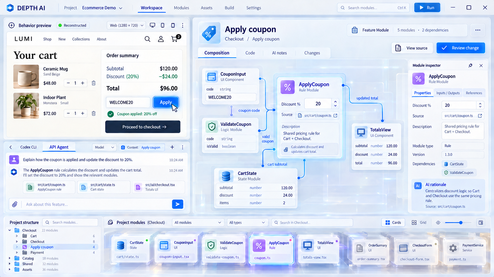
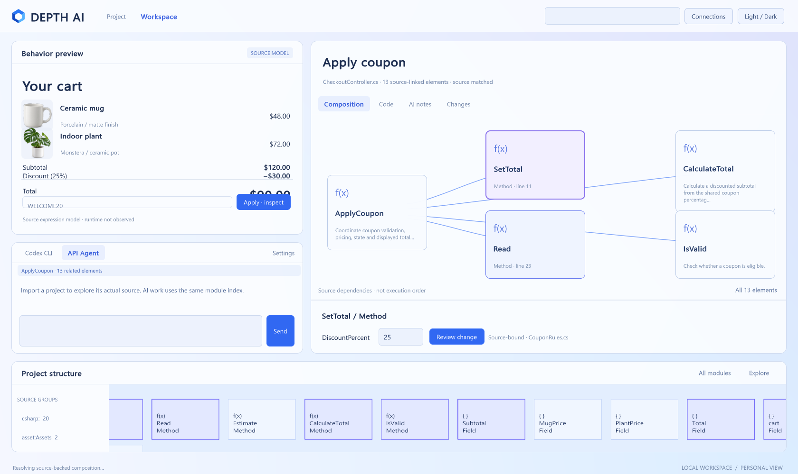

# Depth AI 개발 중단과 디자인 실패 인수인계

2026년 10월 29일 사용자는 오늘의 개발을 중단하고, 내일 이어서 작업할 수 있도록 **레퍼런스 재현 실패와 프로젝트의 핵심을 기록해 Git에 푸시**하라고 지시했다.

**현재 EXE는 레퍼런스의 모습을 제대로 구현하지 못했다. 어시스턴트가 구현을 잘못한 상태다.** 사용자가 원한 것은 반투명 유리 재질과 깊이, 정교한 모듈 표현을 갖춘 Meta 분위기의 공간형 개발 환경이었다. 실제 결과는 단순한 평면 패널과 사각 모듈을 연결한 초기 UI에 가깝다. 기능 테스트 통과는 이 디자인 실패를 상쇄하지 않는다.

## 사용자의 마지막 피드백

사용자는 이전 갤러리에서 위쪽의 단순한 클릭/배치 예시와 아래쪽의 imagegen 레퍼런스가 너무 다르다고 지적했다. 어시스턴트는 위쪽은 예시이며 실제 구현은 아래쪽 시안의 분위기를 따르겠다고 말했다. 그러나 실제 EXE도 그 단순한 예시와 비슷하게 나왔다. 사용자는 “레퍼런스 이미지의 모습은 온데간데없다”, 한 시간 이상 작업과 토큰을 소비했는데 왜 이런 결과를 만들었는지 이해할 수 없다고 강하게 항의했다.

이 피드백을 다음 작업에서 잊거나 “분위기는 맞췄고 기능만 남았다”로 바꾸어 해석하면 안 된다. **레퍼런스 재현에 실패했고, 현재 UI는 사용자에게 승인되지 않았다.**

사용자는 분위기 자체는 좋다고 했지만 최신 탐색 시안 1번은 너무 난잡하므로 더 간결하게 해 달라고 했다. 밀도 감소 요청은 그래픽의 깊이·재질·완성도를 없애라는 뜻이 아니다.

## 목표 이미지와 현재 결과

다음 이미지들은 비교 기준이다. 최근 생성한 단순화 시안까지 사용자가 최종 승인했다고 주장하면 안 된다.

| 구분 | 파일 | 의미 |
| --- | --- | --- |
| 현재 우선 비교 기준 | [정면 선택 화면 라이트](../design/storyboards/meta-focus-20261029/02-light-focused-composition-v2.png) | 오른쪽 정면 구성판과 하단 프로젝트 탐색대, 선호한 Meta 계열 분위기 |
| 코드와 AI 작업 기준 | [라이트 코드 화면](../design/storyboards/meta-focus-20261029/03-light-source-agent.png) | 프리뷰·채팅·코드·AI 근거·전체 프로젝트의 공존 |
| 다크 분위기 기준 | [다크 정면 구성](../design/storyboards/meta-focus-20261029/05-dark-focused-composition-v2.png) | 같은 구조의 다크 모드 |
| 과밀 지적 대상 | [최근 탐색 1번](../design/storyboards/meta-focus-20261029/01-light-explore.png) | 분위기를 유지하되 모듈 진열·선·빛·테두리를 줄여야 함 |
| 초기 공간과 로고 | [초기 4번](../design/explorations/preview-collection-20261029/04-ivory-overview.png) | 사용자가 선호했던 입체 유리 표현과 파란 입체 로고의 기준 |
| 초기 다크와 배경 모듈 | [초기 5번](../design/explorations/preview-collection-20261029/05-desktop-glass-collect.png) | 뒤편 파편이 실제 모듈이고, 선택하면 앞으로 모이는 아이디어의 출발점 |
| 미승인 단순화 제안 | [간결한 탐색 시안](../design/implementation-baseline/01-calm-overview.png) | 어시스턴트가 이번 작업 중 생성. 사용자의 최종 승인 없음 |
| 미승인 단순화 제안 | [간결한 선택 시안](../design/implementation-baseline/02-calm-focused.png) | 다음 구현 비교에 활용할 수 있으나 현재 EXE가 이 수준이라는 뜻이 아님 |
| 실제 구현 결과 | [EXE 탐색 캡처](screenshots/2026-10-29-native-overview.png) | 실제 프로그램의 현재 모습. 레퍼런스 재현 실패 상태 |
| 실제 구현 결과 | [EXE 선택 캡처](screenshots/2026-10-29-native-focused.png) | 평면 패널·단순 모듈 표현과 프리뷰 간격 문제를 확인할 수 있음 |

[레퍼런스와 실제 EXE를 나란히 비교](visual-handoff.html)

### 목표 레퍼런스

### 실제 EXE 결과

## 우리가 만드는 제품

Depth AI는 **사람과 AI가 실제 소프트웨어의 구조를 함께 이해하고 수정·재사용·재구성하는 개발 플랫폼**이다. 웹·앱·게임을 모두 대상으로 한다. 단순 AI 코드 생성기, 쇼핑 앱, 노드 뷰어, 예쁜 3D 데모가 목적이 아니다.

프리뷰는 항상 보여야 한다. 사용자가 프리뷰의 버튼·UI·객체·기능을 선택하면 관련된 실제 코드, 상태, 구성 요소와 에셋이 모듈로 모여 그 기능의 구성을 보여준다. 사용자는 모듈을 선택해 코드와 속성을 읽고 수정한다. AI도 같은 모듈 인덱스와 출처를 검색하고 필요한 소스를 읽는다.

모듈에는 목적·생성 이유·설계 근거·의존성·소스 위치·검증 상태가 들어간다. 이 설명은 AI가 다음 작업에서 구조를 다시 찾기 위한 공통 데이터다. 사용자 댓글 기능이나 모델의 내부 추론 원문을 저장하는 뜻이 아니다. 단순 폰트·이미지에는 불필요한 장문 설명을 붙이지 않는다.

공유 구현은 하나만 존재하고 여러 기능이 참조한다. 시각적으로 모듈이 앞으로 모이더라도 코드 파일을 복제하는 의미가 아니다. 궁극적으로 기능의 분리·다른 프로젝트와의 통합·재사용이 쉬워져야 한다. 현재는 이 궁극적 통합 기능이 구현된 상태가 아니다.

## 확정된 화면 동작 방향

1. 탐색 중에는 왼쪽 프리뷰, 오른쪽의 실제 모듈 공간을 본다. 수천 개를 같은 크기로 모두 펼치지 않는다.
2. 기능 선택 시 관련 모듈의 화면 표현이 앞으로 모인다. 실제 ID와 공유 참조를 유지한다.
3. **선택한 기능은 오른쪽 정면 작업판에 표시한다.** 구성·속성·코드·AI 근거를 읽고 클릭하기 쉬워야 한다.
4. **전체 프로젝트와 하이어라키는 아래쪽 탐색대로 내려간다.** 선택한 기능을 편집하면서 다른 기능과 출처도 계속 찾을 수 있어야 한다.
5. 코드·입력·프리뷰·선택한 모듈의 글자를 사선으로 기울이지 않는다. 깊이는 모듈 몸체와 전체 탐색 공간에서 표현한다.
6. 기존 CLI는 MCP로 같은 프로젝트와 연결한다. API 키 채팅도 같은 모듈/소스/변경 검토 흐름으로 개발해야 한다.

라이트/다크 모두 Meta 분위기의 유리·진주빛·블루·바이올렛 계열을 유지한다. 사용자는 이후 파란색 사용을 허용했다. 색을 베이지·브론즈·세이지로 크게 바꾼 방향은 현재 기준이 아니다. 금색 A/삼각형 로고도 거부됐다. 현재 복원 기준은 초기 4번의 파란 입체 심벌이며, 기존 로고의 정확한 형태에 대한 추가 확인 답변은 받지 못했다.

프리뷰는 항상 게임을 실행하는 에뮬레이터만을 뜻하지 않는다. 소스에 연결된 화면과 동작 설명도 가능하다. 단, 소스 확인·런타임 관찰·AI 추정·미검증을 구분해야 한다.

## 이번 구현에서 실제로 들어간 것

- Unity 6 Windows 클라이언트 `DepthWorkbench.cs`: UI Toolkit 화면, 탐색/선택 배치 전환, 코드·AI 기록·변경 검토 탭, 라이트/다크, 검색·소스 모듈 목록.
- `DepthSpatialField.cs`: 실제 인덱스 ID를 가진 제한된 수의 3D 오브젝트와 선택. 현재 표현은 단순해서 레퍼런스 수준에 미달한다.
- 독립 .NET 서비스의 `WorkspaceIndex.cs`: 소스 모듈 레코드, 호출/필드 참조 기반 구성 조회, 소스에 연결된 숫자 속성, 해시 기반 변경안, AI 기록과 오래됨 표시.
- C# Roslyn 선언·호출·참조 분석, 이미지/폰트 메타데이터 인덱싱. C#은 엔진의 전체 빌드 구성을 로드하지 않는 source-only 분석이다.
- 기존 Dart AST 어댑터. 환경 설정이 필요하며 일반 Flutter UI 프리뷰를 자동 복원하지 않는다.
- `ContextTools.cs`/`McpBridge.cs`: 동일 워크스페이스에 대한 stdio MCP 조회·소스 읽기·AI 설명 기록·변경안 등록.
- `ApiAgent.cs`: API 키·모델 ID를 받는 Responses 도구 호출 루프. 키는 별도 기록으로 저장하지 않는다. 실제 계정의 API 응답이나 실제 Codex 모델 호출은 검증하지 않았다.
- `samples/Checkout`: 실제 C# 소스, 실제 상품 이미지, `depth.preview.json` 매핑과 소스 해시가 있는 AI 설계 기록. 이 예제의 산술식을 제한적으로 해석해 프리뷰 합계를 계산한다. 임의 프로젝트 코드를 실행하지 않는다.
- 소스 속성 변경안의 검토·승인·백업·재분석. 대상 프로젝트 컴파일/행동 보존은 자동 검증하지 않는다.

Checkout은 플랫폼 동작 검증용 예제다. 제품을 이 쇼핑 화면에 종속시키면 안 된다. 일반 프로젝트에는 어댑터가 없으면 프리뷰가 없고 소스 탐색으로 동작한다. 자동 의미 기반 모듈화와 범용 실행 요소 추적이 완성됐다는 뜻이 아니다.

## 검증 결과와 한계

- 서비스 self-test **28개 통과**: 실제 소스 계산식, 공유 구현 참조, draft에서 소스 보존, 승인 적용, 재분석과 ID 유지, 오래된 AI 기록, API 도구 루프 모의 검증 등.
- `tests/native_workspace.py` 통과: 실제 HTTP import/view/composition/property/review/apply와 stdio MCP initialize/list/get/read/record가 같은 워크스페이스를 사용하는 것을 확인했다.
- Windows EXE 빌드 성공. 격리된 복사본에서 숫자 속성 적용과 재분석을 실행했다.
- 실제 EXE 캡처는 창을 표시한 상태에서 확인했다. 숨김 실행에서는 검은 캡처가 나왔으므로 그래픽 검증에 쓰지 않는다.
- 저장한 현재 캡처는 이미 25%로 바뀐 테스트 복사본을 재실행한 모습이다. 숫자가 $90인 것은 그 이유이며, 실제 코드 변경 검증은 위 테스트와 분리해 본다.
- **시각적 완성도와 레퍼런스 일치는 실패했다.** UI 간격/겹침, 단순 평면 재질, 기능에 맞지 않는 단순 함수 기호, 3D 공간의 표현 수준을 재작업해야 한다.

## 생성했지만 적용하지 못한 자산

`unity/Depth.Desktop/Assets/Resources/Depth/Icons/`의 action/logic/state/validation/view PNG는 imagegen으로 생성했다. 사용자가 중단을 지시했을 때 코드에 연결하지 못했다. 현재 EXE가 이 역할별 아이콘을 사용하는 것처럼 말하면 안 된다. 다음 작업에서 자산을 먼저 확인하고 필요에 맞게 적용한다.

`design/implementation-baseline/prompts.json`과 같은 폴더의 manifest, `native-icons.json`에 생성 방식과 프롬프트·출처를 남긴다.

## 다음 작업 순서

1. 루트 `AGENTS.md`와 이 문서를 먼저 읽고 비교 페이지를 연다.
2. 레퍼런스와 현재 EXE의 차이를 직접 본다. 사용자에게 현재 화면이 목표와 같다는 설명을 반복하지 않는다.
3. 하나의 실제 Unity 화면을 골라 재질·역할별 아이콘·간격·구성·밀도를 먼저 맞춘다. 특히 최근 1번의 과밀도를 줄이되 깊이와 그래픽 품질은 유지한다.
4. 프리뷰의 합계/버튼 겹침을 정리하고 선택한 모듈과 속성이 어느 소스의 것인지 명확하게 표시한다.
5. 실제 EXE 캡처를 레퍼런스와 나란히 비교한다. 큰 차이가 남으면 다음 기능을 늘리기 전에 수정한다.
6. 이미 있는 공통 인덱스/변경 검토 흐름을 살리면서 실제 코드 연결을 유지한다. 새 가짜 데이터 데모로 되돌리지 않는다.
7. 그다음 일반 Unity/Flutter/웹 어댑터, 의미적 모듈 경계, 외부 편집 동기화와 실제 에이전트 실행 검증을 확장한다.

추가 점검: 기능별 재분류 적용 시 인덱스 캐시 무효화와 앱 재시작 후 분류 보존을 확인해야 한다. 에셋 인덱싱 추가 이후 레거시 `--export-view`가 바이너리를 텍스트로 읽지 않도록 검토해야 한다. 오늘 중단 이후 이 부분을 수정하거나 완료했다고 보고하지 않는다.

## 실행과 주요 파일

로컬 빌드 결과: `artifacts/windows/Depth AI.exe`. 같은 폴더의 데이터·서비스·Mono 파일이 필요하며 .NET 8 런타임이 필요하다. 빌드 출력은 `.gitignore`에 따라 Git에 포함하지 않고 소스와 검증 캡처를 보관한다.

- 실제 새 클라이언트: `unity/Depth.Desktop/Assets/Scripts/DepthWorkbench.cs`
- 공간 렌더링: `unity/Depth.Desktop/Assets/Scripts/DepthSpatialField.cs`
- 그래픽 기본 요소: `unity/Depth.Desktop/Assets/Scripts/DepthPrimitives.cs`
- 화면 스타일: `unity/Depth.Desktop/Assets/Resources/Depth/Workspace.uss`
- Windows 빌드: `unity/Depth.Desktop/Assets/Editor/DepthBuild.cs`, `scripts/build.ps1`
- 서비스: `src/Depth.Service/`
- 실제 예제: `samples/Checkout/`
- 검증: `tests/native_workspace.py`, `src/Depth.Service/WorkspaceFeaturesTest.cs`

`DepthDesktop.cs`와 이전 HTML/3D 시안은 이력으로 남아 있다. 현재 빌드의 장면은 `DepthWorkbench`를 사용한다. 이전 시안이 있다는 이유로 그것을 선택된 최종 디자인으로 간주하지 않는다.
