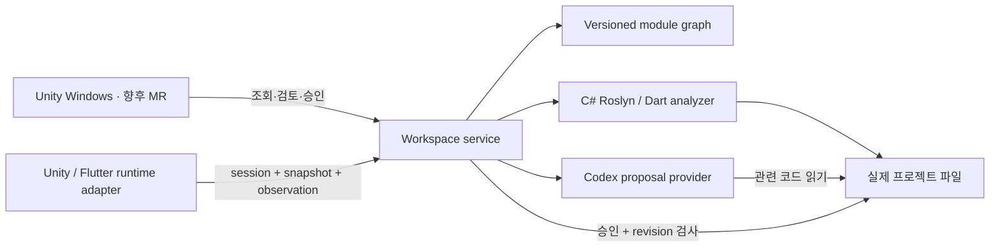

# Depth AI 아키텍처 / 결정 기록 001

## 목적과 계층

실제 코드가 원본이고 인덱스는 버전이 있는 파생 데이터입니다. 사용자와 에이전트는 동일한 Graph를 사용합니다. Unity는 시각화·선택·검토 UI를 담당하고 분석·파일 쓰기·CLI 실행은 서비스에서 수행합니다. 엔진 객체를 공통 모델의 필수 타입으로 사용하지 않습니다.

## 공통 데이터 계약

실행 가능한 계약은 `src/Depth.Service/Model.cs`, Unity DTO는 `Contracts.cs`입니다. JSON schemaVersion은 1.0입니다. 장기적으로 DTO는 이 계약으로 생성하고 버전 호환 검사를 추가해야 합니다.

- **Project / revision**: 정규화한 로컬 root를 프로젝트 ID로 사용하며 정렬된 소스 경로+내용 해시 집합으로 snapshot revision을 만듭니다. 초기 로컬용 ID입니다. 협업에서는 저장소 UUID + branch + commit + working-tree revision으로 교체합니다.
- **Entity**: 실제 구현의 canonical ID, 언어, 종류, qualified name, 복수 source anchors. partial 타입은 하나의 엔티티에 여러 위치를 가집니다. 같은 함수의 여러 사용처는 새 구현이 아니라 관계입니다.
- **Anchor**: 상대 경로, 시작·끝 줄, 전체 파일 내용 해시. 줄 번호만으로 수정하지 않습니다. 현 구현의 C# ID는 Roslyn documentation symbol ID이므로 파일 이동·메서드 본문 변경에는 안정적이지만 이름·시그니처 변경 시 새 ID입니다. Dart ID는 파일+소유 범위 기반이라 파일 이동 시 변경됩니다. 추후 rename refactoring event와 구조 fingerprint로 명시적인 ID migration을 기록합니다.
- **Relation**: from/to, contains/calls/constructs/inherits, 발생 위치, evidence. 데이터 흐름·참조·asset ownership은 향후 추가할 별도 관계입니다. 아직 알 수 없는 관계를 추정해서 static으로 표시하지 않습니다.
- **Module**: 목적과 기능을 나타내는 엔티티 집합. 엔티티의 주 소유 모듈은 하나이고 공유 구현은 관계로 재사용합니다. 초기 디렉터리 영역은 `inferred/directory-seed`; AI 제안은 승인 후에도 `inferred/ai-reviewed`입니다. 사용자 승인은 의미적 정확성의 증명이 아닙니다.
- **Evidence**: static / observed / inferred 및 수집 방법·설명. 설계 근거는 검증 가능한 짧은 설명이며 내부 추론 기록은 저장하지 않습니다.
- **Proposal / ChangeRecord**: 기준 revision, 변경 이유, 파일별 예상 해시·수정본, 영향 모듈, 결과 revision, 검증 상태. before bytes와 제안은 서비스 changes 디렉터리에 저장됩니다.
- **RuntimeSelection**: project/revision/session/object ID + 소스 경로. 현재 엔드포인트는 선택 관찰만 보관합니다. 향후 RuntimeObject, Component, Asset 엔티티와 timestamp/trace 기반 observed edge로 확장합니다.

## 분석과 동기화

C#은 SDK에 포함된 Roslyn을 사용합니다. AST로 선언을 얻고 source-only Compilation의 semantic model이 정확히 하나의 대상에 바인딩한 경우에만 내부 호출 관계를 만듭니다. Unity 어셈블리·asmdef·define·NuGet 의존성이 없는 상태는 진단에 노출합니다. 외부 호출이나 해석 실패는 누락될 수 있습니다. 초기 분석 결과를 Unity 빌드 성공으로 간주하지 않습니다.

Dart는 별도 프로세스의 analyzer AST를 사용합니다. Flutter import/생성 코드/pubspec은 아직 의미적으로 해석하지 않으므로 AST 선언 범위만 표시합니다. 다음 단계는 AnalysisContextCollection의 resolved units와 element 기반 심볼 식별자, 라이브러리 URI, resolved invocation 수집입니다.

현재 5초 전체 재분석은 작은 프로젝트용입니다. 다음 단계는 파일 감시 + debounce + dirty-file queue + 언어별 증분 분석 + 관계 invalidation입니다. snapshot을 원자적으로 교체해 화면과 에이전트가 중간 상태를 읽지 않도록 합니다. 현재 프로세스 내 lock과 graph 파일 교체가 구현되어 있습니다. 소스 변경 시 AI 분류와 런타임 관찰은 보수적으로 만료됩니다.

쓰기 전 전체 소스 snapshot과 파일별 해시를 검사합니다. 오류 시 이 프로세스가 쓴 내용과 일치하는 파일만 복구합니다. 여러 파일의 OS 수준 원자적 transaction이나 crash recovery는 아직 없으므로 큰 리팩토링에는 별도 Git worktree와 패치 적용/병합 계층이 필요합니다. 새 파일·삭제·이동은 초기 제안 계약에서 제외했습니다. 소스 심볼릭 링크는 스캔/쓰기에서 제외합니다. 출력·패키지 폴더는 제외하며 20,000개 소스 상한을 둡니다.

## 시각화 선택

| 표현 | 장점 | 약점 | 결정 |
|---|---|---|---|
| 2D 리스트/트리 | 검색·정확한 위치·키보드 접근에 유리 | 복합 관계·공간 기억 표현이 약함 | 항상 보조 탐색으로 제공 |
| 자유 3D 그래프 | 관계와 공간 기억을 표현 | 가림·카메라 길 잃음·edge 폭증 | 기본 화면으로 채택하지 않음 |
| 중첩 큐브 | 포함 계층을 명확히 표현 | 기능 공유와 여러 종류의 관계 표현이 경직됨 | 고정 디자인으로 삼지 않음 |
| 계층형 공간 지도 + 선택 주변 펼치기 | 기능 요약→구현으로 단계적 탐색, MR에 자연스럽게 확장 | 집계 품질과 레이아웃 안정성이 필요 | 기본 방향으로 제안 |

현재 화면은 고정 직교 시점의 공간 영역·목록·inspector이며 한 페이지 18개 영역, 선택된 영역과 직접 연결된 선만 표시합니다. 검색·선택 주변 필터·소스 세부정보를 지원합니다. 시각적 완성도를 위한 첫 기반이며 semantic zoom, 고정 좌표 저장, 마이크로 애니메이션, LOD 클러스터는 미구현입니다. 대규모 렌더링의 최종 형태는 기능 집계→모듈→심볼의 3단계 확대와 검색 결과 우선 렌더링입니다. 수천 개 오브젝트를 동시에 생성하지 않습니다.

## 실행 화면과 코드 연결

Unity: opt-in Editor bridge가 MainCamera raycast 또는 Hierarchy 선택으로 실제 GameObject를 얻습니다. 연결된 MonoBehaviour → MonoScript → AssetDatabase 경로를 사용합니다. 대상 project/revision 일치 검사 후 관련 소스의 모듈을 선택합니다. GlobalObjectId는 에디터 지속 식별용이고 동적 인스턴스는 session+instance로 구분합니다. 현재 컴포넌트 소속만 관찰하며 클릭한 캐릭터의 실제 행동·애니메이션·셰이더·에셋 인과관계를 모두 추적한 것으로 표시하지 않습니다.

후속 Unity adapter: Editor에서 GUID/fileID/type mapping을 export하고 Development Build에 선택 hook을 포함합니다. 네트워크 엔티티/spawn ID와 asset GUID를 함께 기록합니다. 외부 실행 화면의 픽셀만으로 코드를 확정하지 않습니다.

Flutter: debug VM Service / widget inspector의 선택 element와 creation location, element lifecycle ID를 연결할 별도 어댑터가 필요합니다. release build에서는 소스 위치가 없는 경우가 있으므로 opt-in instrumentation 및 build manifest가 필요합니다. 현재 미구현입니다.

## AI와 검증

Provider는 CLI와 추후 API 구현을 교체할 경계입니다. 현재 `codex exec --sandbox read-only --json --output-schema`를 네이티브 실행 파일과 stdin으로 호출하고 제안만 수집합니다. 리뷰 UI에서 승인받아 service가 수정합니다. shell 문자열로 사용자의 프롬프트를 실행하지 않습니다. 구조화된 output도 파일 해시·경로·엔티티 소유권 검증을 다시 거칩니다. CLI 실패/시간 초과는 실패로 표시합니다. CLI 계정/API 키는 Depth가 저장하지 않습니다.

MCP는 로컬 Codex 설정을 통한 외부 도구 사용 가능성만 상속합니다. Depth MCP 도구 서버는 미구현입니다. 향후 `search_modules`, `get_module`, `get_source`, `get_relations`, `propose_change`, `get_validation`을 같은 서비스를 사용하는 도구로 제공합니다. 현재 prototype은 그래프 전체를 prompt에 넣기 때문에 대규모 토큰 절감을 주장할 수 없습니다. API 키 provider 및 세밀한 MCP 권한 검토도 후속 작업입니다.

검증기는 re-index, syntax, build, tests, runtime assertions를 각각 별도 결과로 기록해야 합니다. 현재 자동으로 수행되는 것은 re-index뿐이며 UI/기록에 이를 명시합니다. 프로젝트 실행은 임의의 import 때 자동 실행하지 않고 사용자 선택 검증 profile로 분리할 계획입니다.

벤치마크는 같은 저장소·요구사항·모델·예산으로 전체 코드 탐색 대 인덱스 탐색을 비교합니다. input/output tokens, 읽은 bytes, 시간, 수정 성공률, 빌드/테스트 성공률, 누락 관계의 precision/recall을 기록해야 하며 현재 수치는 없습니다.

## 프로젝트 생성·통합 및 협업 확장

새 프로젝트 생성은 framework template + dependency lock + 검증 profile + 최초 인덱스를 하나의 작업으로 다룹니다. 두 프로젝트 통합은 기능 계약/의존성/에셋·라이선스 검토 → 대상 프로젝트 adapter 설계 → 격리 branch에서 구현 → build/test/runtime 검증 → 승인 병합 순서입니다. 모듈은 코드 묶음 외에 입력/출력/효과/환경 제약/테스트/검증 근거를 가진 재사용 자산으로 확장합니다. 단순 파일 복사를 통합 완료로 처리하지 않습니다.

Windows 우선. 이후 MR 클라이언트도 같은 DTO·query contract를 사용하며 렌더링과 입력만 XR로 교체합니다. 공통 데이터는 project revision·module graph·변경 이력·검증 결과입니다. 카메라·개인 선택·필터·확대 상태는 사용자별 view state입니다. 선택 공유는 명시적인 presence 이벤트이고 공통 그래프 변경과 구분합니다. 협업 서비스는 revision 기반 optimistic concurrency, 작업 lease, audit, 접근 권한을 담당하며 소스 코드를 무조건 CRDT로 합치지 않습니다.

## 참고한 공식 문서

- [Codex non-interactive mode](https://learn.chatgpt.com/docs/non-interactive-mode): JSON 이벤트와 schema 기반 결과 수집.
- [Roslyn SemanticModel](https://learn.microsoft.com/en-us/dotnet/api/microsoft.codeanalysis.semanticmodel): 심볼 바인딩과 선언 분석.
- [Unity Windows command-line build](https://docs.unity.com/en-us/engine/6000.3/manual/building-and-publishing/build-command-line): 배치 에디터 빌드.
- [Unity GlobalObjectId](https://docs.unity3d.com/ja/current/ScriptReference/GlobalObjectId.html): 에디터 객체 식별.
- [Dart analyzer](https://pub.dev/packages/analyzer): 언어 분석 adapter의 기반.
